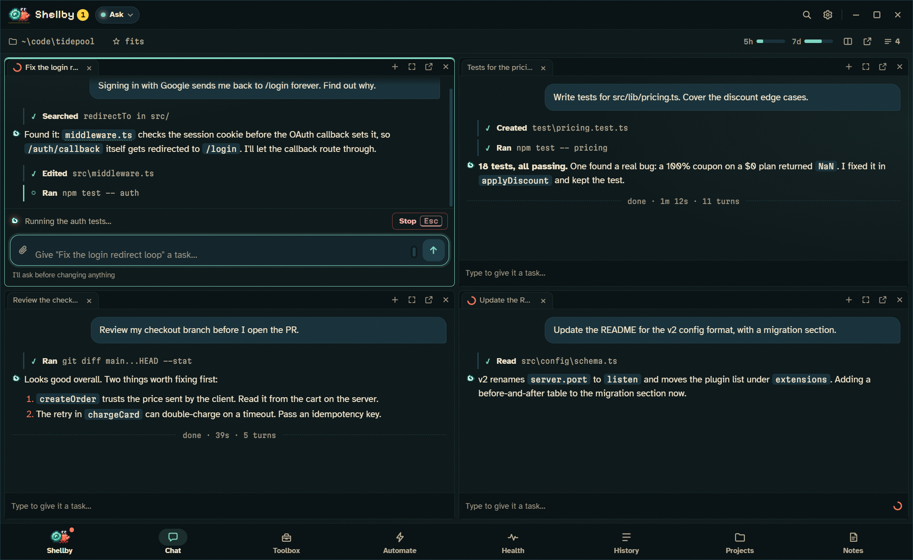
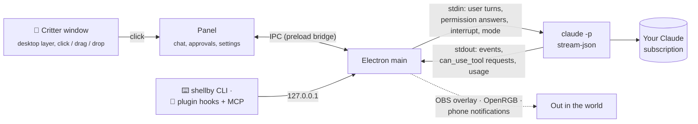

<div align="center">


[](https://github.com/x-salmon/shellby/releases/latest)  [](https://github.com/x-salmon/shellby/releases) [](LICENSE) [](https://github.com/x-salmon/shellby/actions/workflows/cli-compat.yml) [](https://scorecard.dev/viewer/?uri=github.com/x-salmon/shellby)

## Same Claude Code. Less babysitting.

Parallel tasks on their own branches, undo for any turn, and routines that start the moment your limit resets,<br>
all on **your own Pro or Max plan**, on Windows 10 and 11. No API keys, no per-token billing.<br>
**And a pixel hermit crab who scuttles off to do it.**

### [⬇ Download for Windows](https://github.com/x-salmon/shellby/releases/latest)

[Website](https://getshellby.com/) · [What's new](#whats-new) · [Why Shellby, if you have Claude Code?](docs/WHY-SHELLBY.md) · [Community packs](https://getshellby.com/community/) · [How it works](#how-it-works) · [Skins](docs/SKINS.md) · [Security](SECURITY.md) · [Changelog](CHANGELOG.md)

<br>


**1.** Tell him what you want &nbsp;→&nbsp; **2.** Helper crabs work on it side by side &nbsp;→&nbsp; **3.** He brings it home, and you both level up

<sub>([MP4 version](docs/img/shellby-demo.mp4))</sub>

</div>

**Already use Claude Code?**

- 🧠 **It's the real `claude`.** The official CLI you installed and signed in to. No model of its own, no fork.
- 🔁 **Nothing to migrate.** Your skills, agents, hooks, MCP servers, `CLAUDE.md` files and permission rules carry over, and anything you set up in Shellby works in your terminal too.
- 🛠️ **The difference is the tooling.** Parallel work, undo, review, scheduling and alerts, so you don't have to script them yourself. **[Why Shellby, if you have Claude Code →](docs/WHY-SHELLBY.md)**

**What can it do to my repo without asking?** Only what you've allowed: the default **Ask first** mode asks before every edit and command your own rules don't already permit, and the fenced-off Autonomous mode is never on unless you pick it. A tab can work in its own copy of the repo on its own branch that only merges back when you say so, never with a force-push, and **Undo** puts back every file a turn changed. [Permission modes →](#permission-modes)

**Before you install**

<details>
<summary><b>Does it use extra tokens?</b></summary>

No. Your tasks go through your own `claude`, so they count against your Pro or Max plan just as they would in a terminal. Shellby only makes a Claude Code call of its own when you turn on a feature that needs one (**Keep warm**, or reading Linear or Jira issues for a project), and each turn shows its tokens and its share of your 5-hour window.
</details>

<details>
<summary><b>Does it send my code anywhere?</b></summary>

Only to Anthropic, through Claude Code, the same as in your terminal. Shellby has no servers, no accounts of its own and no telemetry. Sync and crash reports are off until you say yes. The [privacy policy](PRIVACY.md) lists every connection, and [SECURITY.md](SECURITY.md) covers how to report a problem.
</details>

<details>
<summary><b>Do I need to open a terminal?</b></summary>

No. If Claude Code isn't on your PC, the first screen offers to install it with Anthropic's official installer, then opens the sign-in in your browser.
</details>

<details>
<summary><b>Can I uninstall cleanly?</b></summary>

Yes. The uninstaller asks whether to delete your data (`%APPDATA%\Shellby` and `%LOCALAPPDATA%\Shellby`) as well. Claude Code and your `~/.claude` settings belong to Claude Code, so they stay.
</details>

---

## Get started

1. **[Download the installer](https://github.com/x-salmon/shellby/releases/latest)** (`Shellby-Setup-x.y.z.exe`) and run it on Windows 10 or 11.
2. Pick **Claude Code + crab** (uses your Claude Pro or Max plan), **Work mode** (the same tools, first on the bar, and a quiet crab), **Claude Code on another computer** (over ssh), or **Just the crab**: no Claude, no account, still a desk pet who talks, plays and dresses up.
3. He moves onto your desktop. Click him to open the panel.

Windows may show a SmartScreen warning the first time; [Install](#install) explains it, along with the Claude Code setup.

## Everything he can do

Already use Claude Code on this PC? The tool screens are on the bar from the start: **History**, **Projects**, **Notes**, **Health**, the **Toolbox** and **Automate**. New to it, you start with just him, a chat box and **First steps**: open a project, give Claude a task, see what he changed, and say hi to the crab. Each step ticks itself off when you really do it, and any of them can be skipped. The tool screens open as he works: History, Projects and Notes after his first task, Health and the Toolbox after his third, Automate after his fifth. The game side of his screen (Finds, Stickers, Crew, the Bugdex, the Council, Us, the Tank, a project's Reef and Review mastery) waits until First steps are done or he reaches level 3, then opens as tasks earn it, each with a "new" on its door. Can't wait? **More → Show every screen**, or **Settings → General → Screens → Show everything now**, puts them all out, and [Work mode](docs/DESKTOP.md#work-mode) starts with every one of them. If you used Shellby before First steps existed, nothing changes for you.

| | |
|---|---|
| ⚡ **[Gets things done](#-he-gets-things-done-with-claude-code)** | Helper crabs, tabs on their own branches, undo any turn, comments on the diff |
| 🗂️ **[Runs your dev day](#️-he-runs-your-dev-day)** | Every repo and dev server, crash help, flaky tests, time per project |
| 🌊 **[Gets out more](#-he-gets-out-more)** | Your terminal, your phone, CI on your pull requests, your stream and GitHub |
| 🔒 **[Keeps you in control](#-you-stay-in-control)** | Permission cards, five modes, a spending guard, nothing leaves your PC |
| 🦀 **[And a crab who does the work](#-and-a-crab-who-does-the-work)** | How you see Claude working, plus a desk pet, outfits and PC health if you want them |

## ⚡ He gets things done with Claude Code

<table>
<tr>
<td width="50%"></td>
<td width="50%"></td>
</tr>
<tr>
<td align="center"><sub>Helpers work in parallel, each in its own lane</sub></td>
<td align="center"><sub>Lean Shell shows what every conversation carries</sub></td>
</tr>
</table>

**Work in parallel**


<p align="center"><sub>Drag a tab into the chat to split it: up to twelve conversations side by side, or pop one out into its own window</sub></p>

- **Helper crabs:** every subagent gets a lane in the panel and a crab on your desktop, and each kind levels up into a named crew member.
- **Tabs on their own branches:** each one works in its own copy of the repo. **Bring it home** merges it back, never with a force-push.
- **Up to twelve side by side,** or branch from any turn to **try it another way**.

**Keep your code safe**
- **Undo any turn,** or any step within one, including what a script or `npm install` did.
- **Run checks** stamps your test results on a turn, with before and after pictures.
- **Comment on the diff,** line by line, and send all your comments back as one follow-up.
- **Learns from your corrections:** correct Claude the same way twice and he offers to add it to `CLAUDE.md` as a rule.

**See what it costs**
- Every turn shows its tokens and its share of your 5-hour window, and **Lean Shell** shows what each new conversation carries before you type.
- **Keep warm while you're away:** press the mug in the tab strip before lunch. Each conversation of 200k tokens or more gets one tiny message just before its cache's hour runs out, so your first message back reads the conversation from the cache instead of writing it all again. It turns itself off when you're back, or after 3 hours. [Why pinging is cheaper →](docs/WHY-SHELLBY.md#-questions-developers-ask)

**Work your way**
- <kbd>Ctrl</kbd>+<kbd>K</kbd> for everything, every slash command, and push-to-talk.
- **All files** (<kbd>Ctrl</kbd>+<kbd>Shift</kbd>+<kbd>F</kbd>): the whole project beside the chat, each file with its git mark, lit up as Claude reads, writes and commits. Click a file and it goes along with your messages, so "this" means that file.
- A **Toolbox** for your skills, agents, MCP servers and hooks, and a **Council** of advisor crabs for big decisions.
- Hand a conversation to the terminal and back, or run Claude Code on another computer over ssh.

**[Everything he does with Claude Code →](docs/CLAUDE-CODE.md)** · **[Already use Claude Code in a terminal or editor? Here's what he adds →](docs/WHY-SHELLBY.md)**

## 🗂️ He runs your dev day

<table>
<tr>
<td width="50%"></td>
<td width="50%"></td>
</tr>
<tr>
<td align="center"><sub>Every repo you work in, and its dev servers</sub></td>
<td align="center"><sub>A crash, with what to send Claude a click away</sub></td>
</tr>
</table>

- **Projects:** the repos you work in, here and on GitHub, with their branches and unpushed work. **Start** a dev server and a `:5173` pill sits by the crab.
- **When a server crashes** he holds up a red sign. The card marks the error lines and shows exactly what would go to Claude, and nothing is sent until you say so.
- **Start from where the work is:** **Fix this build** on a red pull request sends Claude the failing step's log, **Address the review** quotes the comments still open (a new review comment offers it on its notification), and **Next up** ranks what to work on in each project (your tasks, your notes, its GitHub issues and milestones, the TODOs in its code), each with **Do this**: a conversation in a copy on its own branch, the prompt waiting for you to send.
- **Notes for later:** jot an idea on a project's Notes, or ask Claude to note it from the chat. **Plan**, **Build** or **Ask** turns one into a conversation, Plan and Build in a copy of their own.
- **Time on each project:** hours worked out from what he already sees, clients and rates, a PDF or CSV timesheet, and a day at a time to Toggl, Clockify or Harvest when you send it. Off until you turn it on.
- **Flaky tests** caught and fixed for real, **dependencies** checked weekly with a pull request to bump them, and **Is it safe to leave?** before you lock up or shut down.
- **He knows your limits:** when you'll hit your 5-hour window, and a message held for after the reset goes by itself.
- **Run it when my limit resets:** queue heavy tasks ("refactor X", "write tests for Y") on the Routines page, for when the window resets or for tonight. They start by themselves, overnight too, one after another, with the PC kept awake. Each result goes to your phone, and a task that runs out of usage partway carries on after the next reset.
- **Workflows and routines:** a schedule, a red build, a release or a file landing in a folder starts a list of steps: Claude, commands, web requests, a question for you. [Workflows](docs/WORKFLOWS.md).
- **Your MCP servers in them:** tick the servers a step may use and Claude files the Linear issue or posts to Slack without stopping to ask, or call one tool directly with no Claude turn at all. Pair it with [n8n](docs/N8N.md) for everything else.

<p align="center"></p>

**[Projects, time, tests and dependencies →](docs/PROJECTS.md)**

## 🌊 He gets out more

<table>
<tr>
<td width="50%" valign="top">

```powershell
shellby do "tidy my Downloads"
shellby do @review
shellby say "all green"
shellby status
shellby time last-week
```

**From any terminal,** and Claude can drive him too, through the plugin's MCP server: have him say what a skill is up to, or celebrate when a release lands. It can't start tasks of its own.

</td>
<td width="50%" valign="top">


</td>
</tr>
</table>

- **📱 Your phone:** a permission prompt, a finished run or a red build can reach it. ntfy is one QR scan, and Telegram finds your chat by itself. Answer Allow or Deny from it if you like.
- **🎥 On stream:** an OBS browser source on a transparent background. **💡 On your desk:** OpenRGB lighting that follows his mood. **🎛️ On a Stream Deck:** Allow, Deny, Stop, Bring it home and Ready to review as hardware keys, each showing what's waiting. **🎮 On Discord:** his level and what he's up to on your profile.
- **✅ CI on your pull requests:** a ✗ sign when a build goes red, a dance when it's fixed, and **Fix this build** to hand Claude the failing log.
- **Sync and visiting crabs,** with an optional GitHub sign-in that only asks for what you turn on.

**[Phone, stream, lights and GitHub →](docs/CONNECTIONS.md)**

## 🔒 You stay in control

- **Permission cards:** **Allow**, **Always allow** or **Deny**, with <kbd>Y</kbd> / <kbd>A</kbd> / <kbd>N</kbd>. The card warns you when a command runs a script Claude wrote, or an edit touches Claude Code's own setup.
- **Five permission modes,** from Ask first to a fenced-off Autonomous. See [Permission modes](#permission-modes).
- **Spending guard:** routines and workflows stop before they use the share of your 5-hour window you keep for yourself.
- **Your plan, your PC:** no API keys, no telemetry, and your history stays on your PC.

---

## 🦀 And a crab who does the work

<p align="center"></p>

He's how you see the work without opening anything. He scuttles while Claude works, raises a claw when it needs you, sends a helper crab out for every subagent, holds up a red sign when a build breaks or a dev server crashes, and says *"all green!"* when the tests pass. He lives on the wallpaper layer, behind every window, and there's nothing to look after.

The rest is there if you want it, and none of it needs Claude or an account:

- **A desk pet with a life of his own:** a voice and a temperament (chipper, fussy, cocky or sleepy), little scenes when nothing's happening, finds he digs up, hide and seek and fetch, a bond that grows, a tank to decorate, and a beach with a sandcastle for every project you ship. [On your desktop →](docs/DESKTOP.md) · [His tank →](docs/TANK.md)
- **Dress him up:** 168 accessories, 24 effects and 18 crabs, 97 trophies and 99 levels, a sticker for every repo you ship, and the [Bugdex](docs/BUGDEX.md), where every kind of bug Claude fixes is a creature he scoops into a jar. More from other people in the **[community gallery](https://getshellby.com/community/)**. [Outfits, trophies and stickers →](docs/WARDROBE.md)
- **He watches your PC:** he sweats when the GPU runs hot, gets dizzy when memory's full and overstuffs his shell when a drive fills up, with live vitals, what's hogging it, what starts with Windows and the developer clutter you can clear. [How Health works →](docs/HEALTH.md)
- **Things to try:** throw him at a title bar and he rides the window, fling him at the edge of the screen and he climbs it, rub the mouse over him to pet him. Pals, typing along and pranks stay off until you turn them on. [All of it →](docs/DESKTOP.md)

**Work mode** keeps him to himself: your tools lead the bar, he only speaks up about the work, and the climbing, pals, pranks and confetti take the day off. Turning it off puts every setting back as it was. [Work mode →](docs/DESKTOP.md#work-mode)

<p align="center"></p>

## What's new

<table>
<tr>
<td width="33%" valign="top">

**👣 The trail** · 0.82<br>
<sub><kbd>Ctrl</kbd>+<kbd>Shift</kbd>+<kbd>E</kbd> opens a map of the files Claude has touched, with him walking it: footprints where he read, dug-over files where he changed things, and a replay of every step. [See](CHANGELOG.md#0820-the-trail)</sub>

</td>
<td width="33%" valign="top">

**★ Marks past 99** · 0.81<br>
<sub>XP keeps counting after the top level: each mark shows as 99★1, 99★2…, with its own countdown and celebration. [See](CHANGELOG.md#0810-marks-past-99-zoomed-panes-and-named-layouts)</sub>

</td>
<td width="33%" valign="top">

**🪟 Twelve panes** · 0.80<br>
<sub>Up to twelve conversations side by side, each pane with its own tabs and box. Zoom one, name a layout or keep one per project, and <kbd>Alt</kbd>+<kbd>J</kbd> finds the one waiting for you. [See](CHANGELOG.md#0800-twelve-panes-each-with-its-own-tabs)</sub>

</td>
</tr>
<tr>
<td width="33%" valign="top">

**🎨 Code in colour** · 0.79<br>
<sub>Replies stream in as Claude writes them, code is coloured by language, Mermaid diagrams are drawn, and diffs go side by side with <b>Undo this part</b>. [How](docs/CLAUDE-CODE.md)</sub>

</td>
<td width="33%" valign="top">

**🧭 Outline, Problems and Debug mode** · 0.79<br>
<sub><kbd>Ctrl</kbd>+<kbd>Shift</kbd>+<kbd>O</kbd> for every message and the files it touched, <kbd>Ctrl</kbd>+<kbd>Shift</kbd>+<kbd>M</kbd> for the errors your checks found, and <code>/debug</code> to fix a bug from live logs. [See](CHANGELOG.md#0790-routines-that-follow-you-live-replies-and-code-in-colour)</sub>

</td>
<td width="33%" valign="top">

**🔁 Routines that follow you** · 0.79<br>
<sub>Your routines and workflows sync to your other PCs, arriving switched off so nothing runs twice. [See](CHANGELOG.md#0790-routines-that-follow-you-live-replies-and-code-in-colour)</sub>

</td>
</tr>
</table>

<sub>And before that: the Council, undo to here, every conversation at a glance, seventeen new bugs, a glow-up, tools in bulk, helpers that report back, one-click modes, Search Settings, bug battles, other computers over ssh, his tank, Next up, the Bugdex, mods, <code>/tries</code>, MCP servers in workflows, the weekly crab card, Lean Shell, projects and dev servers, the flaky test detective, prompt snippets and time on each project. Everything is in the [changelog](CHANGELOG.md).</sub>

## Install

**Just the crab:** download **Shellby-Setup-x.y.z.exe** (or the portable build) from [Releases](https://github.com/x-salmon/shellby/releases/latest), run it, and pick **Just the crab**. That's it: Health, the Wardrobe, his voice, trophies and crab cards, no account. You can add Claude Code later from Settings.

**Crab + Claude Code:**

1. **Install Claude Code** and sign in with your Claude account (Pro or Max):
   ```powershell
   npm install -g @anthropic-ai/claude-code
   claude auth login
   ```
2. Download **Shellby-Setup-x.y.z.exe** (or the portable build) from [Releases](https://github.com/x-salmon/shellby/releases/latest) and run it.
3. Shellby walks you through a two-step check (CLI found ✓, signed in with a Claude account ✓) and asks how much freedom he gets.

**From a package manager:** instead of downloading the installer,

```powershell
scoop bucket add shellby https://github.com/x-salmon/shellby
scoop install shellby/shellby
```

or `winget install x-salmon.Shellby`, once Microsoft's review of the package finishes. Scoop keeps him up to date with `scoop update shellby` (the in-app updater stands aside); a winget install updates itself like the regular installer.

> **"Windows protected your PC"?** That's Microsoft SmartScreen. It warns about any app that isn't code-signed or that few people have downloaded yet, and Shellby releases aren't signed yet.
>
> - **To install anyway:** click **More info → Run anyway**.
> - **To check you got the real file:** every release is built by [GitHub Actions](https://github.com/x-salmon/shellby/actions/workflows/release.yml) from the tagged commit, and each one lists SHA-256 checksums in `SHA256SUMS.txt`. Compare them with `Get-FileHash .\Shellby-Setup-x.y.z.exe`, or build from source (below).

**Updating:** the installed version updates itself. He checks GitHub Releases, downloads in the background, and puts a dot on the ⚙ gear when an update is ready. Click **Restart and update** in **Settings → About**, or **Update to x.y.z and restart** in the tray menu, or just quit and it installs on the way out. Your settings live in `%APPDATA%\Shellby`, so they carry over. The portable build can't update itself: download the new `Shellby-Portable-x.y.z.exe` from [Releases](https://github.com/x-salmon/shellby/releases/latest) and replace the old one.

**Keeping Claude Code current:** Claude Code checks for its own updates only in an interactive terminal session, and the sessions Shellby starts aren't interactive, so a copy that only ever runs under Shellby would stay on the version you installed. Once a day Shellby asks the npm registry which version is newest and, if yours is older, says so once and puts an **Update** button in **Settings → About**, beside Shellby's own. It runs Claude Code's own `claude update`. Pick **Update it for me** there and he does it himself, only while no conversation is running; **Leave it to me** and he never asks the registry.

**Requirements:** Windows 10 or 11 (x64). For the Claude side: Claude Code 2.1+ and a Claude Pro or Max plan.

## How it works



Shellby doesn't talk to any AI API itself. Each conversation is one long-lived, official Claude Code process that you signed in to yourself, driven over the same stream-json host protocol the Claude Agent SDK uses. Shellby never sees your Claude sign-in, and usage counts against your plan's normal limits, exactly as if you'd typed the task into a terminal. The protocol, billing safety and how he stays on the desktop layer are in [DEVELOPMENT.md](docs/DEVELOPMENT.md#how-shellby-drives-claude-code).

## Permission modes

| Mode | Reads | Edits files | Runs commands | Notes |
|---|---|---|---|---|
| **Ask first** *(default)* | ✅ | asks | asks | Recommended. |
| **Smart** | ✅ | auto* | auto* | Claude Code's `auto` mode: a safety classifier approves routine steps and blocks risky ones. |
| **Auto-edit** | ✅ | ✅ | asks | |
| **Plan only** | ✅ | ✗ | ✗ | Shellby proposes a plan card, and nothing changes until you approve. |
| **Autonomous** | ✅ | ✅ | ✅ | `bypassPermissions`. Behind an explicit warning, never the default, and never reachable from the `shellby` command. |

Your own Claude Code allow/deny rules in `~/.claude/settings.json` still apply in every mode.

## Build from source

With Node 22 or newer: `git clone`, `npm install`, `npm run setup`, `npm start`. The full setup, every test and maintenance script, and a map of the code are in [docs/DEVELOPMENT.md](docs/DEVELOPMENT.md). Every image in this README is rendered from the real app: `npm run screenshots`, `npm run reel`, `npm run tricks` and `python scripts/make-banners.py`.

## Privacy

Everything stays on your PC. Conversation history lives in `%APPDATA%\Shellby\sessions`, and Shellby has no telemetry and no servers. The [privacy policy](PRIVACY.md) lists every connection he makes and what goes over it. In short:

- Claude Code talking to Anthropic, and the updater checking GitHub Releases.
- GitHub, only if you sign in: your profile, the sync gist, pack pull requests, the CI status of your pull requests, with Visiting crabs on, your public calling card and your friends' cards, with Profile card on, the public gist holding your profile card picture, and with Built with Shellby on, the public `shellby-badge` repository holding his picture and the badge at the bottom of pull requests your tabs open.
- Phone notifications, only if you turn them on, straight to the service you picked (ntfy, Pushover, Telegram, Discord, Slack or your own endpoint).
- The npm registry once a day, to say when a newer Claude Code is out (**Leave it to me** in **Settings → About** stops it).
- Crash reports to Sentry, only when you say so: he asks first, and **Settings → About → Crash reports** changes it.
- Things you ask for: ssh to the computers you add under **Other computers**, community packs, plugins and MCP servers, `git` fetches and pushes, workflow web requests, and the weekly dependency check (npm, pnpm, Yarn, pip-audit, cargo-audit and Go's, whichever your projects use).
- Things that never leave your PC: the time tracker (it reads the title of the window in front to tell which project you're in, keeps only the project, the day and the minutes, and never syncs them; a day goes to Toggl, Clockify or Harvest only when you send it), push-to-talk audio (Windows' offline speech recognizer hears it, and the microphone is only open while you hold the shortcut), your PC's health readings, OpenRGB, the OBS overlay, the Stream Deck keys (behind a token only the plugin has), and the port the `shellby` command and the plugin use — all on `127.0.0.1`.

See [SECURITY.md](SECURITY.md) for the renderer sandboxing details.

## Code signing policy

Releases will be signed with [Azure Artifact Signing](https://learn.microsoft.com/azure/artifact-signing/), under the maintainer's verified name.

> Signing is being set up. Until the first signed release, releases are unsigned (see [Install](#install)). The rest of this section describes how signed releases will work.

Only Shellby's own files are signed, and only when GitHub Actions builds them from a tagged commit in this repository ([release workflow](.github/workflows/release.yml)). The signing key stays in Microsoft's hardware and is never on a PC. Before publishing, the workflow checks that every exe is validly signed by the expected publisher. Before building, it checks that the publisher will match the last release's, so installed copies keep updating. How it works: [docs/SIGNING.md](docs/SIGNING.md).

- **Committers and reviewers:** [x-salmon](https://github.com/x-salmon). Pull requests from anyone else are reviewed before they're merged.
- **Release and signing:** [x-salmon](https://github.com/x-salmon)

Everyone in these roles uses two-factor authentication on GitHub and Azure.

**Privacy:** see the [privacy policy](PRIVACY.md) for everything Shellby sends over the network, and when. It has no telemetry.

## Contributing

Skins, packs, bug reports and PRs are welcome. See [CONTRIBUTING.md](CONTRIBUTING.md), then `npm install`, `npm run setup` and `npm run dev:crab` gets you a dev crab that needs no Claude account.

- **First time?** Pick a [good first issue](https://github.com/x-salmon/shellby/labels/good%20first%20issue) or a [pack wish](https://github.com/x-salmon/shellby/labels/pack%20wish).
- **Made a pack?** Share it in the [community gallery](https://getshellby.com/community/) ([how](docs/ADDONS.md#publishing-to-the-community-gallery)).
- **Questions or show-and-tell:** [Discussions](https://github.com/x-salmon/shellby/discussions).
- **Reviewing security?** Start with the [threat model](docs/THREAT-MODEL.md).

Everyone here follows the [Code of Conduct](CODE_OF_CONDUCT.md).

## License

Shellby is free software under the [GPL-3.0](LICENSE). Read him, change him, share him, build on him. The one condition: if you hand out a changed version, it stays open under the same licence, so fixes find their way back to everyone instead of disappearing into a closed-source app.

The name **Shellby** and the crab as a mascot aren't part of that licence. Fork the code all you want — just give your crab its own name, so nobody downloads yours thinking it's this one. [TRADEMARK.md](TRADEMARK.md) spells out what's reserved and what's fair game.

Contributors keep their copyright and grant x-salmon the right to also license their work commercially ([why](CONTRIBUTING.md#licensing-your-contribution)), so there may one day be paid extras alongside the free crab. The app in this repository stays GPL-3.0 and free.

## Disclaimer

Shellby is an independent open-source project. It is **not affiliated with, endorsed by, or sponsored by Anthropic**. "Claude" and "Claude Code" are trademarks of Anthropic, PBC. Shellby only automates the official Claude Code CLI you install and sign in to yourself, and your use of it is subject to [Anthropic's terms](https://www.anthropic.com/legal/consumer-terms).

Shellby acts on your real files with your real permissions. Read what you approve, and keep backups.

<sub>GPL-3.0 licensed, see [LICENSE](LICENSE) and [TRADEMARK.md](TRADEMARK.md). The bundled fonts, Pixelify Sans, Atkinson Hyperlegible and Martian Mono, are under the SIL Open Font License 1.1 (see [assets/fonts](assets/fonts)).</sub>
