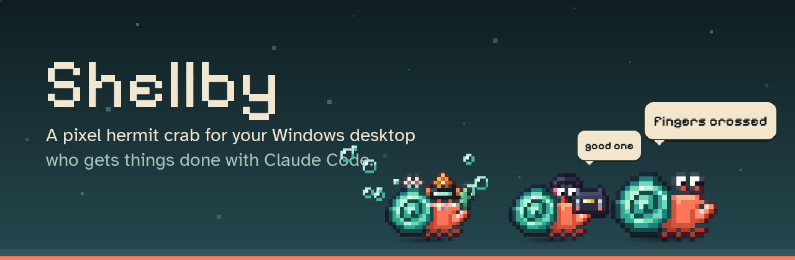
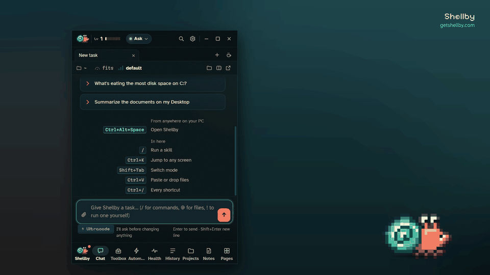
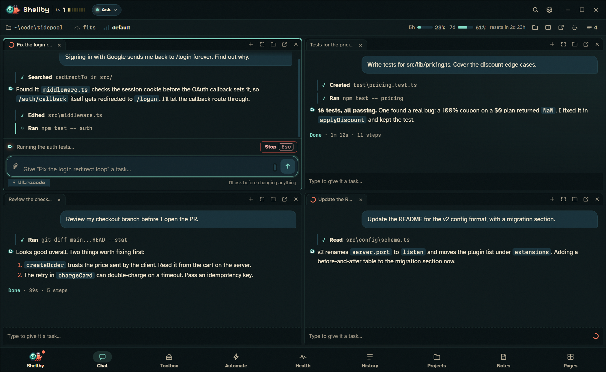

<div align="center">



[](https://github.com/x-salmon/shellby/releases/latest)  [](https://github.com/x-salmon/shellby/releases) [](LICENSE) [](https://github.com/x-salmon/shellby/actions/workflows/cli-compat.yml) [](https://scorecard.dev/viewer/?uri=github.com/x-salmon/shellby)

## Run Claude Code in parallel on Windows.<br>Undo anything. Watch it happen.

Every task gets its own branch, any turn can be undone, and a pixel hermit crab shows you what they're all doing.<br>
**Free and open source**, for Windows 10 and 11.

### [⬇ Download for Windows](https://github.com/x-salmon/shellby/releases/latest)

<sub>Windows may say it "protected your PC": click **More info**, check the publisher is **Jacob Barford**, then **Run anyway**. [Why →](docs/INSTALL.md#windows-protected-your-pc)</sub>

[Why Shellby, if you have Claude Code?](docs/WHY-SHELLBY.md) · [Everything he can do](docs/FEATURES.md) · [Website](https://getshellby.com/) · [Changelog](CHANGELOG.md)

<br>



</div>

- 🌿 **Run it in parallel.** Every tab works in its own copy of your repo, on its own branch, so two tasks never touch each other's files. **Bring it home** merges one back, never with a force-push, and not at all if it would clash. **Ship it** opens a pull request.
- ↩️ **Undo anything.** Puts back every file a turn changed, or just one step of it, including what a script or `npm install` did.
- 🦀 **Watch it happen.** Every subagent walks out as a helper crab. He raises a claw when he needs you, and the permission card can reach your phone.



**It's the real `claude`.** Shellby runs the official Claude Code you installed and signed in to, unmodified. Your skills, agents, hooks, MCP servers, `CLAUDE.md` files and permission rules carry over, and you can go back to the terminal any time.

**There's a lot more** when you want it: reviewing a whole branch, queued and scheduled work, dev servers and projects, your other PCs, Codex, Gemini CLI and local models, and a desk pet with a wardrobe. [Everything he can do →](docs/FEATURES.md)

## Install

1. [Download the installer](https://github.com/x-salmon/shellby/releases/latest) (`Shellby-Setup-x.y.z.exe`) and run it, or use Scoop:
   ```powershell
   scoop bucket add shellby https://github.com/x-salmon/shellby
   scoop install shellby/shellby
   ```
2. Pick **Claude Code + crab**. If Claude Code isn't on your PC, he installs it with Anthropic's own installer.
3. Sign in with your Claude account, or use an Anthropic API key.

He updates himself. Other ways to install, checking a download and updating are in [Installing Shellby](docs/INSTALL.md).

## Questions

<details>
<summary><b>What does it cost?</b></summary>

Shellby is free. Claude Code is billed the way you set it up: your Claude plan's usage, or your Anthropic API key per token. Shellby resells nothing and never sees your Claude sign-in. Each turn shows what it used. [How your sign-in works →](docs/WHY-SHELLBY.md#questions-developers-ask)
</details>

<details>
<summary><b>What can it do to my repo without asking?</b></summary>

Only what you've allowed. **Ask first** is the default and asks before every edit and command your own rules don't already permit. Work in a copy only comes home when you say so.
</details>

<details>
<summary><b>Does it send my code anywhere?</b></summary>

Only to Anthropic, through Claude Code, the same as in your terminal (or to another agent, if you run a conversation on one). Shellby has no accounts of its own and no telemetry. Its only server is a public one that gives sponsors' crabs a signed badge. Sync and crash reports are off until you say yes. The [privacy policy](PRIVACY.md) lists every connection, and [SECURITY.md](SECURITY.md) covers how to report a problem.
</details>

<details>
<summary><b>Can I turn the crab down, or have only the crab?</b></summary>

Both. **Work mode** keeps him quiet and puts the tools first. **Just the crab** needs no Claude and no account.
</details>

<details>
<summary><b>Can I uninstall cleanly?</b></summary>

Yes. The uninstaller asks whether to delete your data (`%APPDATA%\Shellby` and `%LOCALAPPDATA%\Shellby`) as well. Claude Code and your `~/.claude` settings belong to Claude Code, so they stay.
</details>

## Permission modes

| Mode | Reads | Edits files | Runs commands | Notes |
|---|---|---|---|---|
| **Ask first** *(default)* | ✅ | asks | asks | Recommended. |
| **Smart** | ✅ | auto* | auto* | Claude Code's `auto` mode: a safety classifier approves routine steps and blocks risky ones. |
| **Auto-edit** | ✅ | ✅ | asks | |
| **Plan only** | ✅ | ✗ | ✗ | Shellby proposes a plan card, and nothing changes until you approve. |
| **Autonomous** | ✅ | ✅ | ✅ | `bypassPermissions`. Behind an explicit warning, never the default, and never reachable from the `shellby` command. |

Your own Claude Code allow/deny rules in `~/.claude/settings.json` still apply in every mode.

## How it works

Each conversation is one long-lived, official Claude Code process, driven over the same stream-json protocol the Claude Agent SDK uses. Shellby's own code doesn't call Anthropic's API. [The diagram](docs/FEATURES.md#how-it-works) · [How Shellby drives Claude Code](docs/DEVELOPMENT.md#how-shellby-drives-claude-code)

## Code signing policy

Releases are signed with [Azure Artifact Signing](https://learn.microsoft.com/azure/artifact-signing/) as **Jacob Barford**, only when GitHub Actions builds them from a tagged commit here. Committer, reviewer and release approver: [x-salmon](https://github.com/x-salmon). [The whole policy →](docs/INSTALL.md#code-signing-policy) · [Privacy policy](PRIVACY.md)

## Contributing

Skins, packs, bug reports and PRs are welcome: [CONTRIBUTING.md](CONTRIBUTING.md), or pick a [good first issue](https://github.com/x-salmon/shellby/labels/good%20first%20issue). `npm install`, `npm run setup` and `npm run dev:crab` gets you a dev crab that needs no Claude account ([building from source](docs/DEVELOPMENT.md)). Questions and show-and-tell go in [Discussions](https://github.com/x-salmon/shellby/discussions), the [community gallery](https://getshellby.com/community/) has what other people made, and everyone follows the [Code of Conduct](CODE_OF_CONDUCT.md).

Shellby is free and made in spare time. If he saves you some, you can [sponsor him on GitHub](https://github.com/sponsors/x-salmon).

## License

[GPL-3.0](LICENSE): share him, change him, build on him, and keep changed versions open. The name **Shellby** and the crab aren't part of that licence, so give a fork its own ([TRADEMARK.md](TRADEMARK.md)). Contributions may also be licensed commercially ([why](CONTRIBUTING.md#licensing-your-contribution)); the app here stays GPL-3.0 and free.

## Disclaimer

Shellby is an independent open-source project. It is **not affiliated with, endorsed by, or sponsored by Anthropic**. "Claude" and "Claude Code" are trademarks of Anthropic, PBC. Shellby runs the official, unmodified Claude Code you install and sign in to yourself, and your use of it is subject to [Anthropic's terms](https://www.anthropic.com/legal/consumer-terms).

Shellby acts on your real files with your real permissions. Read what you approve, and keep backups.

<sub>GPL-3.0 licensed, see [LICENSE](LICENSE) and [TRADEMARK.md](TRADEMARK.md). The bundled fonts, Pixelify Sans, Atkinson Hyperlegible and Martian Mono, are under the SIL Open Font License 1.1 (see [assets/fonts](assets/fonts)).</sub>
