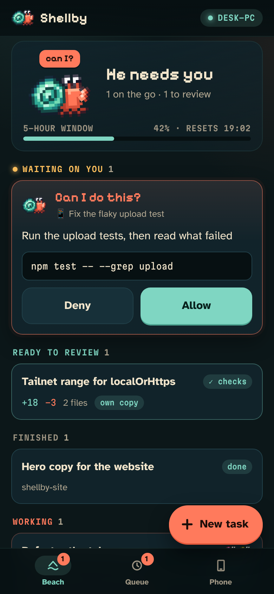
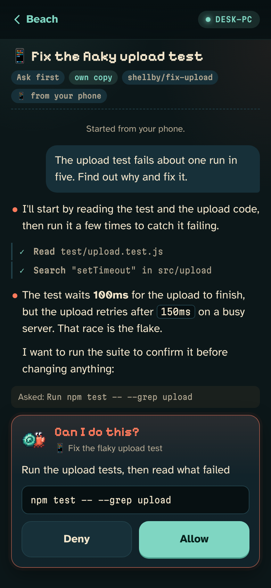
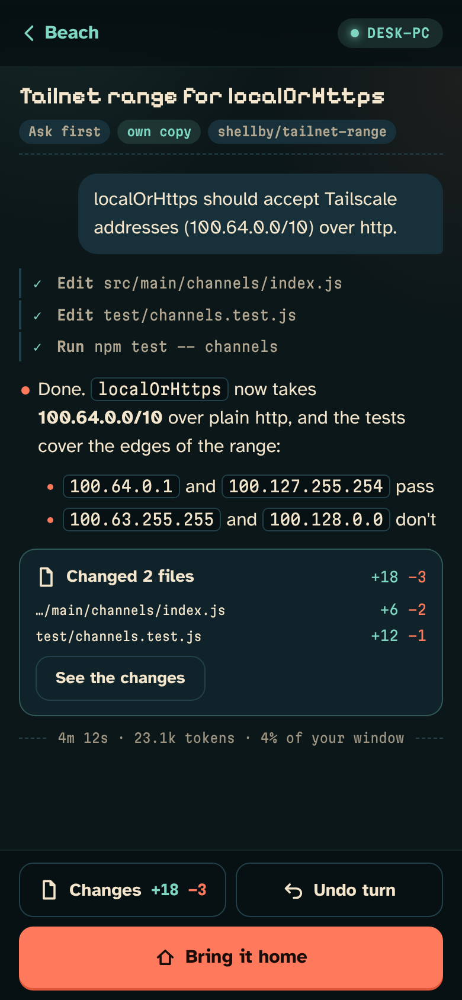
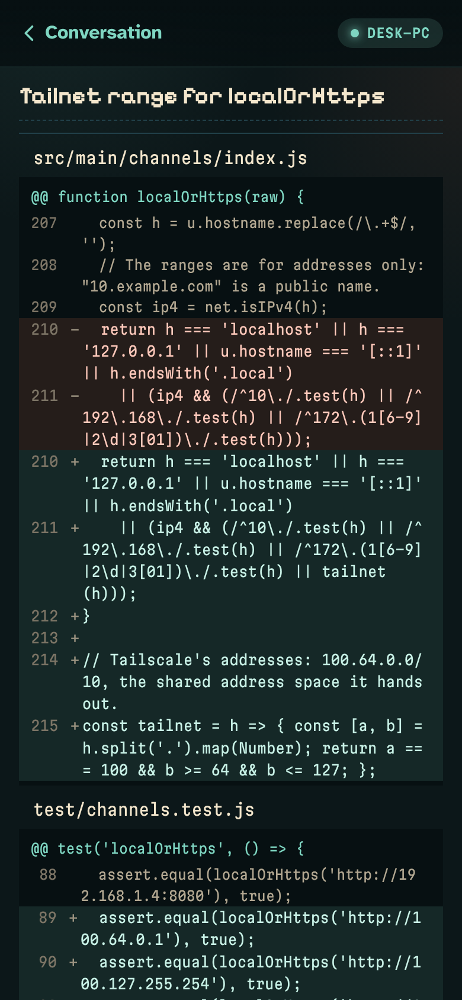

# Shellby on your phone

Your conversations, on your phone, live: what he's doing, what he's waiting on you for, and what's ready to review. Answer Allow or Deny from the sofa, start a task from the bus, read a turn's diff and bring it home. Your PC serves the app itself over your own [Tailscale](https://tailscale.com) network, so there's no account of ours and no server in the middle. Back to [Out in the world](CONNECTIONS.md).

It's off until you turn it on, in **Settings → Connections → On your phone**.

## What you need

- **Tailscale on this PC and on your phone**, signed in to the same account. It's free for personal use.
- **HTTPS certificates turned on for your tailnet**: Tailscale's admin console → **DNS** → **HTTPS Certificates** → Enable. Your phone needs a real certificate to install the app and get notifications. Settings has a button that opens the page.
- iPhone and iPad: **iOS 16.4 or newer** for notifications. Android: Chrome, or any browser that installs web apps.

## Setting it up

Settings walks you through it a step at a time, ticking each one off as it works.

1. **Turn it on.** Press **Put Shellby on my phone**. A confirmation window says what a paired phone can do and who it's for (your Tailscale login), and nothing happens until you say yes. Shellby then asks Tailscale to serve it on your tailnet at `https://<this-pc>.<your-tailnet>.ts.net`.
2. **Open it on your phone.** Scan the QR code Settings shows, or type the address. Open it in **Safari** on an iPhone (Chrome on Android).
3. **Add it to your Home Screen.** Share → **Add to Home Screen**, then open **Shellby** from the Home Screen. On an iPhone this matters: an app on the Home Screen keeps its own storage and is the only kind that gets notifications, so pair it there, not in Safari.
4. **Pair.** Press **Pair a phone** in Settings and type the eight-character code it shows into the app. A code lasts five minutes, takes five tries and works once.
5. **Notifications (optional).** The app asks once you've paired. You can turn them on or off later on its **Phone** screen, and choose which ones on the PC, beside the pairing code.

## What it does

**The beach** is everything at a glance, in the same order as the desk's tabs: what's waiting on you first, then what's ready to review, then what's finished, working and quiet. Shellby himself sits at the top, the real crab in the skin you chose, doing what he's doing on your desktop, with your 5-hour usage window under him.

**A permission prompt** shows as a card with the plain sentence, the command (or the edit, line by line), and any warning the desk card would show. **Allow** and **Deny** answer it straight from the beach, and when the desk card offers **Allow all edits** or **Always allow**, so does the phone. Like answering from a notification, some prompts are only ever answered at the desk:

- a command too long to read on a phone
- running a file Claude wrote this session, or changing Claude Code's own setup

Those say why they wait for the desk (*"It is too long to read on a phone: check it at the desk."*), with **See the conversation** to open it.

**Questions and plans** open in a sheet. A question shows its options as buttons, with a box for your own answer, and **Skip** lets him carry on with his best judgement. A plan shows in full, and **Approve** stays shut until you've scrolled to the end. **Keep planning** sends your notes back with it.

**A conversation** opens live: Claude's reply as he writes it, each tool he runs, his helpers in their own lanes, the to-do list, and what each turn cost. **Stop** ends a turn. When a turn changed files, **See the changes** shows the diff file by file, wrapped to fit, and **Undo turn** and **Bring it home** do what they do at the desk, with the same checks gate and a confirmation on the phone first.

**New task** starts one in any project Shellby knows: the folder you're working in, the ones open in a conversation, and every one he's seen you work in. Tasks from your phone follow the same rules as [phone tasks over Telegram or ntfy](CONNECTIONS.md#-your-phone):

- They run in the mode you pick (Ask first unless you change it: Smart, Auto-edit, Plan only or Autonomous), in their own copy when the folder is a git repository.
- At most 10 start an hour and 3 at once. At your usage limit, or past what the spending guard keeps for you, a task waits for the reset and says when it'll start.
- `!` commands, Claude Code's `/` commands and settings never come from the phone.
- You can reply to any conversation, in the mode you pick under the reply box. The conversation keeps that mode until you change it at the desk.
- **Speak** fills the box using your phone's own dictation, and **Picture** adds up to four photos. They're shrunk to a JPEG on the phone first and kept on the PC like a pasted picture.

**Queue** is what's waiting for the usage reset, with **Take it out** for each one, under your 5-hour and weekly windows, your pace, and what the spending guard keeps back.

**More** has Guard my focus (15, 25 or 50 minutes), **Routines** (Run now, and on or off; workflows that need no inputs run too), **Notes** for each project, and the **Wardrobe**. Tap him on the beach for a pat. A finished conversation has **Share**, which sends a picture of him and what landed through your phone's share sheet.

**Phone** has notifications, what this phone can do, and **Forget this phone**.

### What you can allow

Settings → On your phone has two more things a paired phone may do, each off until you turn it on:

- **Read a conversation's files**, read-only. `.git`, `node_modules`, `.env` files, keys and other likely secrets are never shown, and nothing outside the conversation's folder is.
- **Push after bringing a copy home**, with the secret scan and the question about other people's commits on your PC first.

There's also a quiet **"working on it"** notification for tasks the phone started, which the "done" replaces. iPhones show it like any other notification; on Android it sits silently.

**When the PC sleeps** the app keeps what it last knew, says how old it is ("This is how things were at 09:12"), and comes back by itself the moment the PC answers.

## Notifications

Notifications come from your PC, encrypted, through your phone's own push service (Apple's, Google's, Mozilla's or Microsoft's, whichever your browser uses). Only your phone can read them. They follow the same rules as the other phone notifications:

- **The events you pick:** he needs permission, a task finished, the usage limit, a queued task, a red build and the rest.
- **Guard my focus** holds them back, unless you say otherwise.
- **A four-second task doesn't buzz you.** A task the phone started always says when it's done.

Tap one and the app opens on that conversation. On an iPhone there are no buttons on a web app's notification, so the card is a tap away instead. The app icon's badge counts the prompts waiting.

## Security, in short

This is the one feature that lets another device drive Claude Code on your PC, so it stacks the checks:

- **Shellby listens on `127.0.0.1:47916` only.** Nothing on your Wi-Fi can reach it. Only Tailscale's `serve` can, and only for devices on your tailnet.
- **Only your Tailscale login gets in.** Tailscale tells Shellby who each request is from, and anyone else on a shared tailnet is turned away. **Funnel** (which puts an address on the open internet) is never turned on, and if it's ever on for this address, Shellby stops serving.
- **Each phone needs a code from your PC's screen** to pair, and keeps a token only it has. Shellby keeps a hash of it, never the token, and **Forget** in Settings ends that phone's access at once.
- **The phone's rules:** Allow, Deny and the desk's always-allow, the mode you pick, limits on how many, and everything the desk card would warn about stays at the desk.

The details are in [SECURITY.md](../SECURITY.md#shellby-on-your-phone).

## When it doesn't work

| What you see | What to do |
|---|---|
| **Tailscale isn't on this PC yet** | Install it from [tailscale.com](https://tailscale.com/download/windows) and sign in. |
| **Turn on HTTPS certificates** | Tailscale's admin console → **DNS** → **HTTPS Certificates**. Settings' button opens the page. |
| **Tailscale didn't put Shellby on your tailnet: Serve is not enabled** | Your tailnet needs Serve allowed once. Press **Turn on Serve** in Settings, which opens the page Tailscale names. |
| **Tailscale Funnel is on for this address** | Turn Funnel off (`tailscale funnel reset`, or in the admin console), then turn Shellby on your phone on again. |
| The phone says **Couldn't reach your PC** | The PC may be asleep, or Tailscale off on one of them. The app reconnects by itself. |
| **That code has run out** | Press **Pair a phone** again for a fresh one. |
| No notifications on an iPhone | Open Shellby from the Home Screen (not Safari), then **Phone → Turn them on**. Check Settings → Notifications → Shellby on the iPhone too. |
| **This phone isn't paired any more** | It was forgotten on the PC, or Shellby on your phone was turned off and on with another Tailscale account. Pair it again. |
